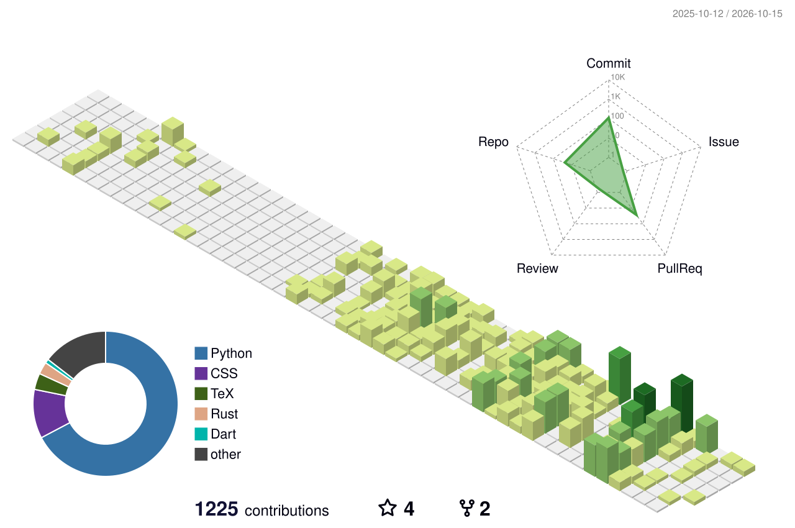

# Dami-wq-k03

I build practical AI systems, with a focus on traceability, reliability, and useful outcomes.

Contact: [wenqiaokang@outlook.com](mailto:wenqiaokang@outlook.com)

### Selected work

[**nano-lmcache**](https://github.com/Dami-wq-k03/nano-lmcache) 
A step-by-step implementation of KV cache reuse, with runnable examples for prefix matching and cache storage. 
Python · LLM inference · [Examples](https://github.com/Dami-wq-k03/nano-lmcache/tree/main/examples)

### Activity

<picture>
  <source media="(prefers-reduced-motion: reduce)" srcset="./profile-3d-contrib/profile-green.svg">
  <source media="(prefers-color-scheme: dark)" srcset="./profile-3d-contrib/profile-night-green.svg">
  
</picture>

Updated daily from GitHub activity.
